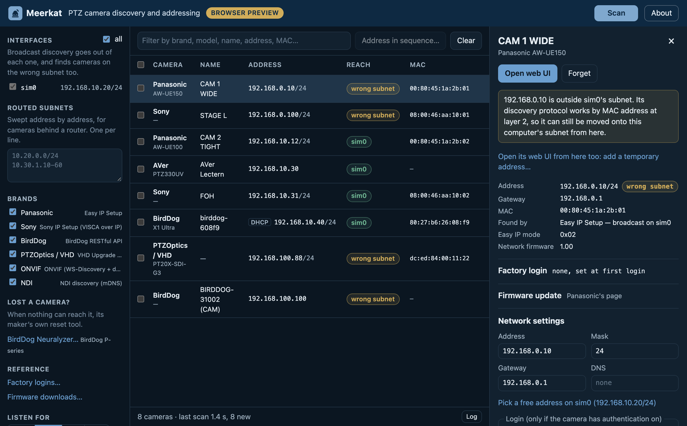
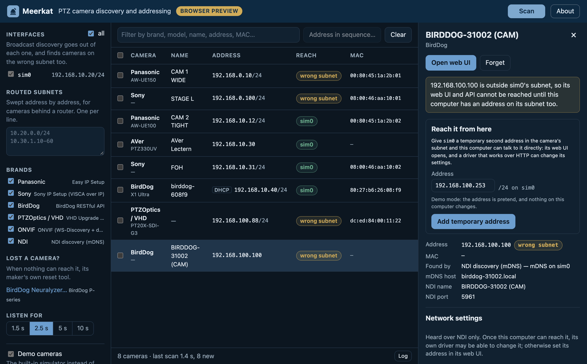

# Meerkat

> **AI-assisted project.** This codebase was created with [Claude](https://claude.com/claude-code)
> (Anthropic), directed and reviewed by a human author. **Nothing here has been tested against a
> real camera yet.** Every protocol is exercised end to end against a built-in simulator that
> answers the way each vendor's documentation says the cameras do, and discovery has been run
> (read-only) on a real network. See [Status](#status) before you change the address of a
> camera you care about.

**Find every PTZ camera on the network, give it the right address, open its web page.**
Meerkat speaks each brand's own discovery protocol, so it finds cameras that are on the wrong
subnet as well as the right one. It can re-address them where the brand allows it, and it opens
each camera's built-in web UI with one click.

| Brand | Finds it with | Can change its address | Notes |
| --- | --- | --- | --- |
| **Panasonic** (AW-UE, AW-HE) | Easy IP Setup broadcast (UDP 10670 → 10669) | Yes, by MAC, even on the wrong subnet | Only in the first 20 minutes after power-on, unless the camera allows unlimited time. No DHCP. |
| **Sony** (SRG, BRC, ILME-FR7) | Sony IP Setup broadcast (UDP 52380) | Yes, by MAC, even on the wrong subnet | Unless the camera has locked IP setup (BRC-AM7 and FR7 lock 20 minutes after power-on). No DHCP. |
| **BirdDog** | NDI (mDNS), confirmed over the REST API on :8080 | X-series and MAX (firmware 6.x): yes, then the camera reboots | P-series and converters (5.5.x): web UI only. |
| **PTZOptics / ValueHD** | VHD upgrade-tool multicast (239.255.255.251:8005) | Not yet: use the web UI, or ONVIF | |
| **Any ONVIF camera** (AVer, Lumens, Marshall, Avonic…) | WS-Discovery (239.255.255.250:3702) | Yes, with the camera's login | Answers are unicast, so a camera on the wrong subnet is not seen this way. |
| **Any NDI camera** | mDNS `_ndi._tcp` | No: the brand's own driver does that | Unknown NDI sources still get a web UI link. |





*Both pictures are the app's interface on its browser preview backend, scanning the eight
simulated cameras. The [user guide](docs/USER-GUIDE.md) covers every control.*

<!-- downloads:start -->

## Download

**[v0.1.0](https://github.com/stoatworks-labs/meerkat/releases/tag/v0.1.0)** — prebuilt for macOS, Windows and Linux. Pick your platform:

<details>
<summary><b>macOS</b> — Universal (Apple Silicon + Intel)</summary>

| Build | Download | Size |
| --- | --- | --- |
| Universal (Apple Silicon + Intel) · .dmg disk image | [`Meerkat_0.1.0_universal.dmg`](https://github.com/stoatworks-labs/meerkat/releases/download/v0.1.0/Meerkat_0.1.0_universal.dmg) | 8.3 MB |

</details>

<details>
<summary><b>Windows</b> — x64</summary>

| Build | Download | Size |
| --- | --- | --- |
| x64 · .exe installer | [`Meerkat_0.1.0_x64-setup.exe`](https://github.com/stoatworks-labs/meerkat/releases/download/v0.1.0/Meerkat_0.1.0_x64-setup.exe) | 3.2 MB |

</details>

<details>
<summary><b>Linux</b> — x64</summary>

| Build | Download | Size |
| --- | --- | --- |
| x64 · .deb package (Debian/Ubuntu) | [`Meerkat_0.1.0_amd64.deb`](https://github.com/stoatworks-labs/meerkat/releases/download/v0.1.0/Meerkat_0.1.0_amd64.deb) | 5.0 MB |
| x64 · .rpm package (Fedora/RHEL) | [`Meerkat-0.1.0-1.x86_64.rpm`](https://github.com/stoatworks-labs/meerkat/releases/download/v0.1.0/Meerkat-0.1.0-1.x86_64.rpm) | 5.0 MB |

</details>

Also in this release:

- [`Meerkat_0.1.0_universal.app.tar.gz`](https://github.com/stoatworks-labs/meerkat/releases/download/v0.1.0/Meerkat_0.1.0_universal.app.tar.gz) — macOS app bundle (updater archive; the .dmg is the install), 8.3 MB

All builds, checksums and release notes: [github.com/stoatworks-labs/meerkat/releases](https://github.com/stoatworks-labs/meerkat/releases).

The Windows builds are unsigned, so SmartScreen warns once.

<!-- downloads:end -->

## Across subnets

A camera fresh out of the box rarely sits on your subnet. Meerkat handles that three ways:

- **Wrong subnet, same wire.** Panasonic, Sony and NDI discovery all work at layer 2, so a camera
  at 192.168.0.10 answers a laptop at 10.0.0.5. Meerkat marks it **Mismatch** and, for
  Panasonic and Sony, can move it onto your subnet by MAC without you touching the laptop's own
  address.
- **Behind a router.** Add a range under **Routed subnets** in the sidebar (`10.20.0.0/24`, `10.20.0.10-60`).
  Meerkat sends each brand's discovery to that subnet's directed broadcast, then sweeps it by
  unicast: an HTTP probe for Panasonic and BirdDog, a UDP inquiry for Sony, a WS-Discovery
  probe for ONVIF. Cameras found that way show as **Routed**.
- **On every interface at once.** Each scan goes out of every network interface (or the ones you
  tick), each socket bound to that interface, so a show laptop with a camera network on one port
  and the venue LAN on another finds the cameras on both.
- **Wrong subnet, HTTP only.** A camera that is heard on the wrong subnet but only talks HTTP
  (BirdDog, ONVIF), or one whose web UI you want to open, gets a **Reach it from here** panel.
  It gives the interface that heard the camera a temporary second address in the camera's
  subnet, so the computer can talk to it directly: its web UI opens, and a driver that works
  over HTTP can change its settings. Meerkat picks a free address near the top of the range,
  which you can change, and refuses one that overlaps a subnet you are already on. The system
  asks for an administrator password. Meerkat removes the address when it quits, and a restart
  removes it too. The addresses in use are listed under **Temporary addresses** in the sidebar,
  each with a Remove button.

## Lost a BirdDog?

A BirdDog P-series given an address nothing can reach can be put back with BirdDog's own
**Neuralyzer**, which resets the camera's network settings. BirdDog has not published how
Neuralyzer talks to the camera, so Meerkat cannot do the reset itself. Instead, **Lost a camera?**
in the sidebar (or the link on a BirdDog that cannot be changed) explains the steps, links to
BirdDog's download, and then **Watch for it** scans every few seconds for up to five minutes. It
probes the factory fallback address, 192.168.100.100, too, and lists any BirdDog that turns up
new or at a new address. A camera that comes back on its fallback address is usually on another
subnet: select it and use **Reach it from here**.

Any driver can name its brand's recovery tool the same way (`recovery` in `DriverInfo`, see
[docs/drivers.md](docs/drivers.md)).

## Changing settings

Pick a camera, change the address, subnet, gateway, DNS or name, and press **Apply**. Meerkat
checks the new settings before anything is sent: is the address already taken by a camera it
can see, is the gateway inside the subnet, does this brand support DHCP. It sends the change and
then looks for the camera at its new address, keeping its row because it is keyed by MAC.
**Pick a free address** suggests the next unused one on the subnet of the interface that heard
the camera.

Several cameras at once: tick them, press **Address in sequence…**, give a starting address, and
Meerkat gives them consecutive addresses in the order shown, one at a time, checking each.

## Opening the web UI

**Open web UI** opens the camera's own page in your browser, on the port that brand uses.

## Factory logins and firmware

For the selected camera, Meerkat shows the login it leaves the factory with and links to its
maker's firmware download page, with the maker's update steps and warnings. Both come from the
makers' own documents, and every fact links to its source. It covers Panasonic, Sony, BirdDog,
PTZOptics, Canon, Lumens, AVer, Marshall, JVC, Vaddio, Datavideo, Avonic, Bolin, Zowietek and
Telycam. **Meerkat never tries a login by itself** (some cameras lock an address out after a few
wrong passwords), and it does not supply or download firmware. The sidebar's **Factory logins…**
and **Firmware downloads…** list every brand.

### Installing a firmware file

A camera that answers ONVIF and says it takes a firmware file over HTTP can be sent one from
Meerkat: **Install a firmware file…** under the camera's firmware section. You download the file
from the maker's page yourself; Meerkat then

1. asks the camera, with its administrator login, what it runs and whether it takes a file
   (ONVIF's `HttpFirmwareUpgrade` capability);
2. shows the file's size and SHA-256 next to the maker's warnings, and waits for you to tick
   that this file is that maker's firmware for that model;
3. sends it the way the ONVIF Core specification publishes (`StartFirmwareUpgrade`, §8.3.9: an
   HTTP POST to the address the camera gives, always at the camera's own IP), waits out the time
   the camera says it will be away, finds it again and reads its version.

Only that version says the install took. Under ONVIF the camera keeps its address and logins.
Brands whose upload is not ONVIF (Sony's, AVer's, Panasonic's) keep the maker's steps and a link.

## Demo mode

Tick **Demo cameras** (or start with `MEERKAT_DEMO=1`, or `--demo`) to run against eight
simulated cameras: two Panasonic, two Sony, two BirdDog, one ONVIF and one VHD. They sit on a
pretend interface, some on the wrong subnet, one locked, one outside its 20-minute window. Every
protocol is answered on loopback, and **nothing is sent to the network** in demo mode: the
engine's sockets are bound to 127.0.0.1 and every destination is rewritten to the simulator or
to a closed port.

## Command line

The same engine without the window:

```bash
cd src-tauri
cargo run -p meerkat-cli -- scan                       # every interface, every brand
cargo run -p meerkat-cli -- scan --range 10.20.0.0/24  # plus a routed subnet
cargo run -p meerkat-cli -- set <camera> --ip 192.168.10.21 --prefix 24 --gw 192.168.10.1        # dry run
cargo run -p meerkat-cli -- set <camera> --ip 192.168.10.21 --prefix 24 --gw 192.168.10.1 --yes  # do it
cargo run -p meerkat-cli -- web <camera>
cargo run -p meerkat-cli -- catalog sony                # factory logins and firmware pages
cargo run -p meerkat-cli -- install <camera> --user admin --pass …         # what it runs, and does it take a file
cargo run -p meerkat-cli -- install <camera> fw.bin --user admin --pass …  # dry run
cargo run -p meerkat-cli -- scan --demo --json         # against the simulator
```

`<camera>` is a MAC, an IP or a row id from the scan. `set` and `install` print what they would
do and do nothing without `--yes`.

## Building

```bash
npm install
npm run app          # Vite on :5175 + cargo, opens the window
npm run app:demo     # the same, against the simulator
npm run app:build    # a release bundle for this platform
npm test             # vitest: the address helpers
cd src-tauri && cargo test --workspace   # drivers, engine, simulator end to end, command layer
```

It is a desktop app and not a web page because discovery needs raw UDP broadcast, multicast and
sockets bound to each interface, which a browser cannot do.

## Adding a brand

Every brand is one file in `src-tauri/crates/meerkat-drivers/src/` implementing the `Driver`
trait. The engine, the UI and the CLI pick it up from `meerkat_drivers::all()`. See
[docs/drivers.md](docs/drivers.md).

## Status

v0.1.0 is the first tagged build: a beta.

- **Never run against real cameras.** Every driver is written from the vendor's public
  documentation and tested against the simulator. The first real Panasonic, Sony and BirdDog
  on the bench are the next test, each one read first and then re-addressed.
- **Panasonic:** cameras with authentication on need their admin login. UE160-generation cameras
  with authentication on use an encrypted variant that Meerkat does not speak. DHCP cannot be
  set over Easy IP.
- **BirdDog P-series** has no network API: Meerkat finds it and opens its web UI. The Neuralyzer
  hand-off and its watch are tested against the simulator only; Neuralyzer itself has not been
  run alongside it.
- **PTZOptics / VHD:** discovery only. The platform's set command is not verified.
- **Factory logins and firmware pages** are read from the makers' documents, not from
  cameras. A row marked *excerpt only* or *not the maker* is weaker.
- **Firmware install** is written from the ONVIF Core specification and tested against the
  simulator only. No real camera has been sent a file yet.
- **Temporary addresses** are tested against the simulator. The system commands that add and
  remove them (`ifconfig … alias` through an administrator prompt on macOS, `ip addr` through
  `pkexec` on Linux, `New-NetIPAddress` through an elevated PowerShell on Windows) are checked as
  strings in the unit tests and have not yet been run on a real interface.

NDI® is a registered trademark of Vizrt NDI AB. See [ndi.video](https://ndi.video).

<!-- attributions:start -->
This project is built on other people's work — see [ATTRIBUTIONS.md](ATTRIBUTIONS.md).
<!-- attributions:end -->

## Licence

MIT. See [LICENSE](LICENSE).
